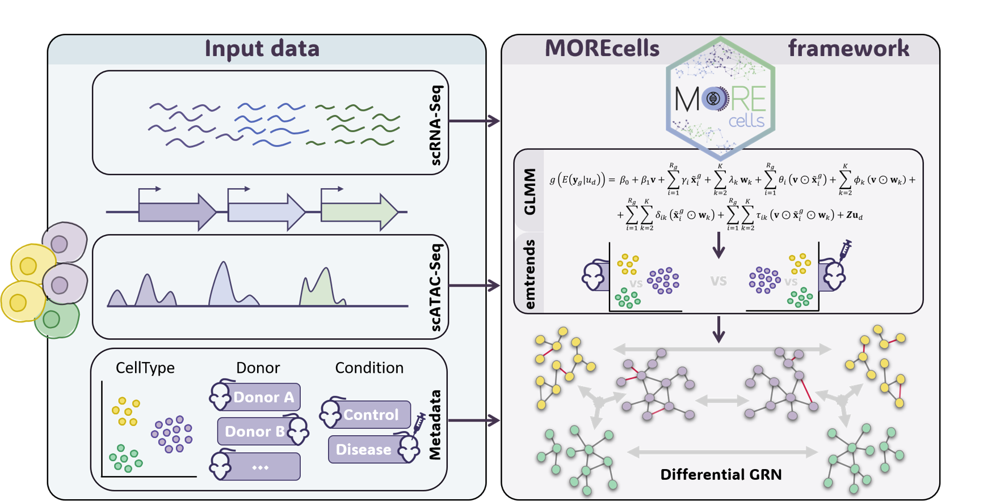

<table>
  <tr>
    <td>
      
    </td>
    <td>
      <h1>MOREcells</h1>
      <p>Regulatory network inference in single-cell multiomic scenarios</p>
    </td>
  </tr>
</table>

`MOREcells` is an R framework designed to analyze gene regulation and multi-omic single-cell data by modeling target omic expression as a function of experimental variables (such as biological conditions, treatments, and cell types) alongside potential regulators of a given target feature, while fully maintaining single-cell resolution and hierarchical data structure.  

To achieve this, MOREcells utilizes a two-step approach that combines Generalized Linear Mixed Models (GLMMs) to account for donor-specific random effects and prevent pseudoreplication, with flexible post-hoc inference options that allow researchers to infer phenotype-specific regulatory networks and perform custom statistical contrasts across different biological groups. 

<div align="center">
  
</div>

## Installation

Currently, the package can be installed directly from GitHub:  

```r
# Install from GitHub (requires devtools) 
devtools::install_github("BiostatOmics/MOREcells")
```

or 

```r
# Install from GitHub (requires remotes)
remotes::install_github("BiostatOmics/MOREcells")
```

---


